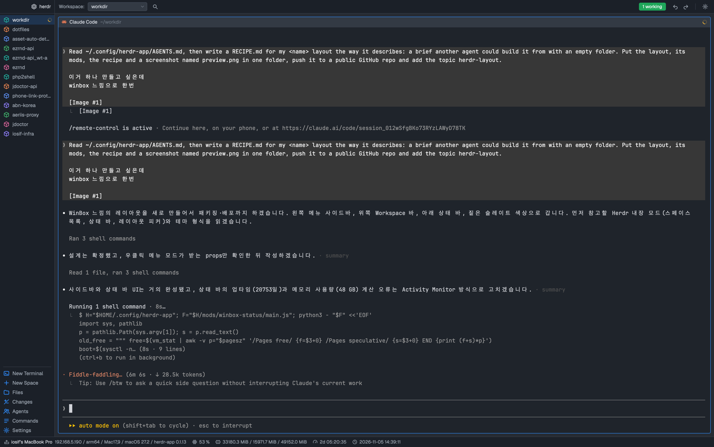

# herdr-winbox

A layout for the [Herdr](https://herdr.dev) desktop app in the style of MikroTik's WinBox 4: a menu column on the left with your spaces as menu items and the agents list under them, a "Workspace:" bar on top with green and blue pills, flat terminal windows in the middle, and a status bar with CPU, memory, uptime and a clock along the bottom.



## Install

Tell the agent in your Herdr window:

> Read ~/.config/herdr-app/AGENTS.md, then add this layout: https://github.com/iosif2/herdr-winbox

It copies `layouts/winbox.json` and the four `mods/winbox-*/` folders into `~/.config/herdr-app/`, checks them and switches to the layout. By hand:

```sh
git clone https://github.com/iosif2/herdr-winbox
cp herdr-winbox/layouts/winbox.json herdr-winbox/layouts/winbox.png ~/.config/herdr-app/layouts/
cp -R herdr-winbox/mods/winbox-* ~/.config/herdr-app/mods/
for m in side top pane status; do herdr-app check ~/.config/herdr-app/mods/winbox-$m; done
herdr-app do layout.switch --name winbox
```

`ctrl-shift-l` cycles back to your other layouts. Delete the files to remove it.

Optional keys (`keys.json`): a command named like a panel toggles it, e.g. `"layout:winbox": { "cmd-e": "winbox-side.files" }`. A layout can add more panel items to the menu with `props.extra` on the `side` block, see [RECIPE.md](RECIPE.md).

## What's where

| region | what it does |
|---|---|
| sidebar (left) | spaces as menu items, `›` unfolds a space's tabs; Herdr's agents list (Working / Idle) under them; then New Terminal, New Space, Files, Changes, Agents, Commands, Settings |
| top bar | Workspace chip (opens the picker), search (command palette), `N working` pill, `N needs you` pill when agents are blocked, update pill when one is ready, `‹ ›` previous/next agent, settings |
| windows | each pane framed as a WinBox window: program, folder, status, split/zoom/close on hover |
| status bar | computer name, `ip / arch / model / OS / herdr-app version`, CPU %, memory used / free / total, uptime, clock |

The status bar runs one small shell script every 5 seconds on this computer (`sysctl`, `vm_stat`, `ps`, `scutil`, `ipconfig` on macOS; `/proc` on Linux). Nothing reaches the network. The full brief another agent can rebuild it from is in [RECIPE.md](RECIPE.md).

## License

MIT.
