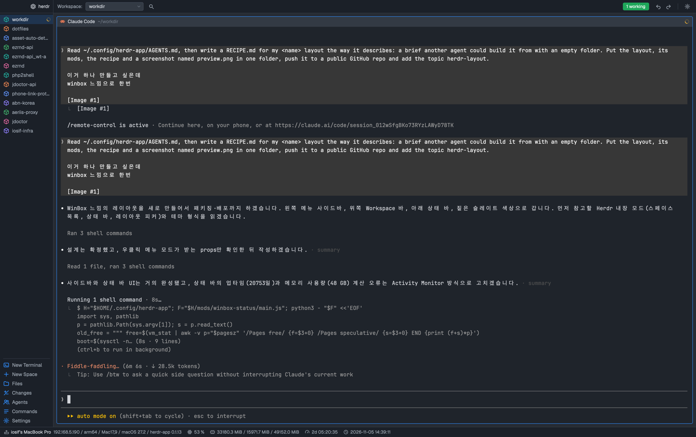

# WinBox

Herdr dressed as MikroTik's WinBox 4: a dark slate window with a menu column down the left where every space is a menu item with a › that unfolds its tabs, Herdr's agents list under them, a bar across the top with "Workspace:" and the shown space in a drop-down chip, green and blue pills on the right, and a status bar along the bottom with this computer's name, address, model, CPU, memory, uptime and a clock with seconds. The shown space's tabs run in a flat strip above the terminals, which sit in the middle as WinBox windows with a title bar each. Nothing animates but the agents' spinners.

## What you see

The whole window is `#262b33` (`canvas`); the bars and the menu column are `#1b2028` (`chrome`), separated by 1px `#353b45` (`border`) lines. Text is `#d7dbe2`, secondary text `#9aa3ae` (`muted`), faint text `#6b7480` (`dim`), the accent `#2f8dff` (WinBox blue). The UI font is Geist; terminals use whatever settings.json says. No system title bar: the layout draws its own and keeps `traffic_lights` at `[12, 10]`.

Top to bottom:

- **Top row**, 34px, two blocks:
  - **Brand**, 200px wide, `chrome`, draggable: after the window buttons (78px of left padding on macOS without a system title bar, 10px elsewhere) a 15px hexagon logo (`logo.svg`, outlined with an inner hexagon) and the word `herdr` at 12px semibold, in `foreground`. Right and bottom border.
  - **Top bar**, the rest, `chrome`, draggable, 10px side padding, 12px text: `Workspace:` in `muted`; a 150 × 22px chip (`raised`, 1px `input` border, radius 4) with the shown space's name and a 12px chevron-down; a 24px search button. Then, pushed right: a red pill `N needs you` / `N need you` only while agents are blocked; a green pill (`done`, `#1fa65a`) reading `N working`, or `N agents` when none works; a blue pill (`accent`) `Herdr <version> ready` only while an app update waits; `‹` `›` (undo/redo icons) for the previous and next agent; a 1px vertical rule; a gear. Pills are 20px tall, 9px side padding, radius 4, white 11.5px semibold text; buttons are 24px squares in `muted` that go `foreground` on `hover`.
- **Body row**:
  - **Sidebar**, a 200px column (id `sidebar`, 44 to 480, not resizable) of three blocks, each `chrome` with a right border: the **menu** (the spaces, `weight` 1, at least 120px), Herdr's own **agents** list (`weight` 1, at least 90px; it draws full rows because the column is wider than 160px), and the **tools** (185px: the fixed items). Menu and tools rows are 24px, 8px left padding, 7px gap, 12.5px text: a 16px line icon (1.5px strokes, round caps, 16-unit grid) in `accent`, the label truncated, then on the right a status mark and/or a 16px chevron. The shown space's row has the `selected` background (`#2f8dff2e`) and `foreground` text; others are `muted` with `hover` on the pointer. Spaces come first, each with a `box` icon tinted in the space's color (Herdr's `space.colors` rule: the same color every Herdr list gives it), a spinner (`mods/workspace-chrome/spinner.svg`, 11px, `working`) while an agent in it works, a 6px dot in `blocked` or `done` when one needs you or finished. A space with more than one tab gets a `chevron-right`; clicking the chevron (not the row) unfolds its tabs as 24px rows indented 16px more, with a `terminal` icon in `dim`, the tab's name (the agent program's name for an unnamed tab), and the same status mark; the shown tab has the `selected` background. The chevron becomes `chevron-down` and the folded state is kept in the mod's own `localStorage` (`open`). The spaces list scrolls. The tools block starts with a 1px `border` rule with 8px side margins, then the fixed items: `New Terminal` (terminal icon), `New Space` (plus), `Files` (folder), `Changes` (changes), `Agents` (two people), `Commands` (three lines), `Settings` (gear). `Files` and `Changes` show `selected` while their panel is open. A layout can add more panel items between `Changes` and `Agents` with `props.extra` on the menu block: `[{ "id": "graph", "label": "Git", "icon": "git" }]`, each toggling the `panel-body` child of that id (the layout adds the block itself).
  - **Work**, a column with 6px vertical and 8px side padding and a 6px gap:
    - **Tabs**, 30px, `chrome`, bottom border, 8px side padding: the shown space's tabs as 24px flat tabs (9px side padding, radius 4, 12px text, 4px apart): the program's icon at 13px (`accent` on the shown tab, `muted` on the others), the name (the agent program's name for an unnamed tab; `⤢` after it when zoomed), a spinner while working, a 6px `blocked` or `done` dot; the shown tab has the `raised` background, a 1px `input` border and `foreground` text, with a 14px × at its end; the others are `muted` on `chrome`. At the right end a 24px `+` button. Many tabs scroll sideways.
    - **Work body**, a row with an 8px gap: the shown tab's panes as WinBox windows (`background` `#1f242b`, 1px `border`, `accent` border when focused, radius 4, 8px gaps, framed even when alone), each with a 26px title bar (`surface`, `raised` when its pane is focused, bottom border, 8px side padding, 12px text): the program's icon (13px, tinted `accent` when it's a glyph), its name in `foreground` medium, the folder (`~`-shortened) in `dim`, then the agent's status: a spinner while working, a red `Needs you` pill (16px, white 10.5px semibold) when blocked, a 7px `done` dot when done. On hover, four 20px buttons: split right, split down, zoom, close.
  - **Panel**, 360px (280 to 900), hidden until `Files` or `Changes` opens it: a stack `panel-body` holding Herdr's `files` and `changes` mods.
- **Status bar**, 26px, `chrome`, top border, 10px side padding, 14px gaps, 11.5px `muted` text, each item a 13px `muted` icon and its text: `host` icon then the computer's name in `foreground` semibold, followed by `ip / arch / model / OS / herdr-app <version>` (empty parts left out); `cpu` icon and `N %`; `memory` icon and `used / free / total` in MiB with one decimal; `uptime` icon and `Nd HH:MM:SS`; `clock` icon and `YYYY-MM-DD HH:MM:SS`. Before the first reading, `…`.

## How it behaves

- **Agent statuses**: `working` is a spinner (menu row, tab row, pane title; the top bar counts them in the green pill); `blocked` is a 6px red dot in the menu, a red `Needs you` pill in the pane title, and the red top-bar pill that focuses the first blocked agent when clicked; `done` is a 6px green dot; `idle` shows nothing.
- **Clicks**: a space row → `space.select`; its chevron → fold or unfold (the row itself never folds; the shown space is always unfolded); a tab in the strip → `tab.select`, double-click → `tab.rename`, its × → `tab.close`, right-click → Herdr's `menu` with `{ tab: "tab", target: { id, space } }`, press one and release on another → `tab.move` there, the wheel over the strip → `tab.prev` / `tab.next`, `+` → Herdr's `new-menu` popup (250 × 512); a tab row → `tab.select`; right-click a space or a tab → Herdr's own `menu` mod as a popup (`{ tab: "space", target: { id } }` / `{ tab: "tab", target: { id, space } }`). `New Terminal` → `tab.new`; `New Space` → `space.new`; `Files` / `Changes` → open the panel on that child (`layout.select` on `panel-body` then `layout.show` on `panel`), switch it, or hide the panel when it already shows that child; `Agents` and the Workspace chip and the green pill → `mod.open` Herdr's `picker` (its own popup, 640px at the top); `Commands` and the search button → `app.palette`; `Settings` and the gear → `app.settings`; `‹` `›` → `agent.prev` / `agent.next`; the blue pill → `app.update`. Pane title buttons → `pane.split` right/down, `pane.zoom`, `pane.close`; the title itself → `pane.focus`.
- **Two-piece menu**: `props.fixed: false` on the menu block leaves out the fixed items, and a second block with `props.role: "tools"` draws only them, so a layout can put Herdr's `agents` list between the spaces and the tools (give that column the id `sidebar`, at least 160px wide, or the agents mod folds into its rail).
- **Keys**: the menu copy listens with `nextCommand()`; a command named like a `panel-body` child toggles that panel, so `"cmd-g": "winbox-side.graph"` in `keys.json` does what a `Git` item does.
- **Hovers**: rows, chips and buttons get the `hover` background; pills dim to 85% opacity; pane title buttons appear only while the pointer is on the title.
- **Dragging** the brand block or an empty part of the top bar moves the window (double-click maximizes); every control stops the press so it doesn't.
- **The status bar** runs one `sh` script every 5 s and redraws every second for the clock and uptime. On macOS: `scutil --get ComputerName`, `ipconfig getifaddr en0` (then `en1`), `uname -m`, `sysctl hw.model`, `sw_vers -productVersion`, `sysctl hw.ncpu hw.memsize hw.pagesize`, `vm_stat` (used = active + wired down + occupied by compressor, times the page size; free = total − used), `sysctl kern.boottime` (the `sec` field). On Linux: `hostname -s`, `hostname -I`, `/sys/devices/virtual/dmi/id/product_name`, `/etc/os-release`, `nproc`, `/proc/meminfo` (MemTotal, MemAvailable), `/proc/uptime`. CPU on both: the sum of `ps -A -o %cpu` divided by the core count, capped at 100. It describes this computer only, whatever machine the shown space is on.

## Built from

- `layouts/winbox.json`: root `column`, `titlebar: "none"`, `traffic_lights: [12, 10]`, `theme: "graphite"` with the `colors` above overriding it (`chrome`, `canvas`, `background`, `surface`, `popover`, `raised`, `hover`, `selected`, `border`, `input`, `foreground`, `muted`, `dim`, `accent`, `accent_foreground`, `solid`, `solid_foreground`, `selection`, `working`, `blocked`, `done`, `idle`, `unknown`), `ui_font: "Geist"`, `background: "canvas"`, `preview: "layouts/winbox.png"`. Children: `top` (row, 34px, not resizable: `brand` block 200px `window_drag` with `winbox-side` props `{ role: "brand" }`, `topbar` block `window_drag` with `winbox-top`); `body` (row: `sidebar` column 200px not resizable holding `menu` (`winbox-side` props `{ role: "menu", fixed: false }`, weight 1, min 120), `agents` (Herdr's `agents` mod, weight 1, min 90) and `tools` (`winbox-side` props `{ role: "tools" }`, 185px); `work` column padding [6, 8] gap 6 with `tabs` (30px, `winbox-tabs`) and `work-body` row gap 8 with `main` (`tab: "active"`, pane frame as above, header `winbox-pane` 26px top always) and `panel` column 360px min 280 max 900 hidden holding stack `panel-body` active `files` with blocks `files` and `changes`); `status` block 26px with `winbox-status`.
- Five mods, each `{ "place": "none" }`, each with its own copy of `shared.js` (a mod can't import from another mod's folder): `icon(name)` → `mods/winbox-side/icons/<name>.svg`, `spaceColor(t, space)` (Herdr's `space.colors` rule), `find(node, id)`, `panelOn(id)`, `togglePanel(id)`, `stop` (stops a press), `pill(t, id, text, color, onClick)`, `dot(color)`.
  - `winbox-side/main.js`: `Side`; `brand(t)` for the brand role, else the menu, whose copy runs the `nextCommand()` loop. Reads `spaces()`, `agents()`, `window()`, `theme()`, `props()` (`role`, `extra`). Icons in `winbox-side/icons/`: `logo`, `box`, `git`, `terminal`, `plus`, `folder`, `changes`, `agents`, `commands`, `settings`, `search`, `chevron-right`, `chevron-down`, `undo`, `redo`, `cpu`, `memory`, `clock`, `uptime`, `host`, `machine`, `split-right`, `split-down`, `zoom`, `close`, `dot`. Every other mod draws from this folder.
  - `winbox-tabs/main.js`: `Tabs`; reads `spaces()`, `panes()`; keeps `pressed` (the tab a press started on) for drag-to-reorder.
  - `winbox-top/main.js`: `Top`; reads `spaces()`, `agents()`, `updates()`.
  - `winbox-pane/main.js`: `PaneTitle`; reads `panes()`, `props().pane`, `home()`.
  - `winbox-status/main.js`: `Status`; `SCRIPT` (a `String.raw` shell script printing `key=value` lines), `exec("sh", ["-c", SCRIPT])` every 5 s, `cx.timer.every(1000)` for the clock, `updates().app.version`.
- Shipped mods it uses: `agents` (the sidebar's list), `files`, `changes` (the panel), `new-menu` (the + button), `picker` (the Agents item and the Workspace chip), `menu` (right-clicks), and `workspace-chrome/spinner.svg`.
- Commands: `space.select`, `space.new`, `tab.select`, `tab.new`, `tab.rename`, `tab.close`, `tab.move`, `tab.prev`, `tab.next`, `layout.select`, `layout.show`, `layout.hide`, `mod.open`, `app.palette`, `app.settings`, `app.update`, `agent.prev`, `agent.next`, `agent.focus`, `pane.split`, `pane.zoom`, `pane.close`, `pane.focus`. Programs: the status script only.

## Watch out

- A mod can't import `../other-mod/file.js`: Herdr refuses modules outside the mod's own folder. That is why `shared.js` is copied into all five folders; change one, change all five. Asset paths (`svg("mods/winbox-side/icons/…")`) are fine across mods.
- `sysctl -n kern.boottime` prints `{ sec = N, usec = M } …`: a greedy `.*sec = ` matches `usec`. Anchor on `^{ sec = `.
- macOS's "Pages free" is tiny on a busy Mac; counting it as free showed 48 GB used of 49. Count used as active + wired + compressor instead.
- The brand block's left padding is for the macOS window buttons; without `titlebar: "none"` or on other platforms it's 10px.
- Herdr's `agents` mod looks for a node with the id `sidebar` and folds into an icon rail when it is narrower than 160px (its own toggle also resizes that node). Keep the column's id and width, or the list shrinks to icons.
- Every clickable in a `window_drag` block must stop its left press (`stop`), or clicking a pill starts dragging the window.
- `space.new` from a mod starts the space on this computer; the menu has no per-machine New Space (the picker's last rows do).
- The status bar's clock redraws the mod every second; that is the only timer besides the 5 s script. Don't add faster ones.
- Herdr 0.1.12/0.1.13 on macOS. Not tried on Linux or Windows; the Linux branch of the script is written from the files it reads, not run.

## Done when

- `herdr-app check` passes for `winbox-side`, `winbox-tabs`, `winbox-top`, `winbox-pane` and `winbox-status`; `layout.switch {name: "winbox"}` shows it and `herdr-app status` has no errors.
- The sidebar shows the spaces on top, Herdr's agents list (Working / Idle groups, full rows) in the middle and the tools at the bottom; dragging the boundary between the first two resizes them.
- With several spaces, the menu lists them with their colors; the shown one is highlighted; a space with two tabs shows `›`, clicking it lists the tabs indented and turns it to `▾`, and the fold survives a reload.
- An agent working in a space puts a spinner on its row and `1 working` in the green pill; a blocked one puts a red dot there, `Needs you` on its pane title, and a red `1 needs you` pill at the top that focuses it when clicked.
- `New Terminal` adds a tab that appears in the strip at once; clicking tabs switches panes, × closes, dragging one onto another reorders, and `+` opens Herdr's new-tab menu.
- `Files` opens the right panel on Herdr's Files and highlights the item; clicking it again closes the panel; `Changes` switches the open panel.
- The Workspace chip and `Agents` open Herdr's picker at the top; the search button and `Commands` open the palette; the gear opens settings.
- The status bar shows the computer's name, `ip / arm64 / Mac17,9 / macOS 27.2 / herdr-app 0.1.13` (or this machine's facts), a CPU percentage under 100, memory as `used / free / total` MiB that adds up, an uptime that counts seconds, and a clock that ticks.
- Dragging the top bar moves the window; clicking a pill or button does not.
